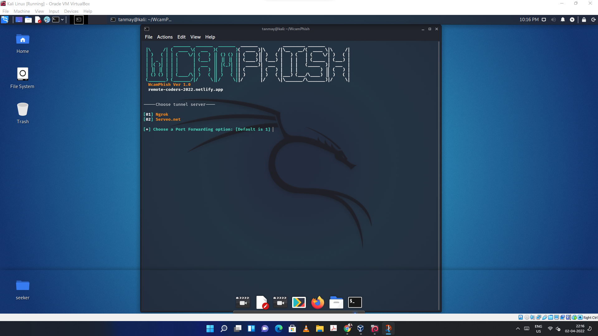

# WcamPhish: Capture Webcam Shots with a Link 📸



**A simple yet powerful tool to grab webcam shots from a target's phone or PC by sending a link. Use responsibly and ethically. The author is not responsible for any misuse of this toolkit!**

[](https://github.com/Tanmay-Tiwaricyber/WcamPhish/stargazers)
[](https://github.com/Tanmay-Tiwaricyber/WcamPhish/network/members)
[](https://github.com/Tanmay-Tiwaricyber/WcamPhish/blob/main/LICENSE)
[](https://github.com/Tanmay-Tiwaricyber/WcamPhish/issues)
[](https://github.com/Tanmay-Tiwaricyber/WcamPhish/pulls)

## Overview

WcamPhish is a penetration testing tool designed to demonstrate the potential risks associated with social engineering and unauthorized access to webcams. By sending a specially crafted link to a target, this tool attempts to capture images from their device's front camera or PC webcam.  It is crucial to understand that using this tool without explicit consent is illegal and unethical. This project is intended for educational and security testing purposes only.

**Key Features:**

*   **Simple Link Generation:** Creates a link that, when clicked, attempts to access the target's webcam.
*   **Cross-Platform Compatibility:** Works on both phone cameras and PC webcams.
*   **Easy to Use:**  Designed for quick setup and deployment.
*   **Educational Tool:**  Illustrates the importance of online security and privacy.

**What Makes This Project Unique:**

WcamPhish provides a straightforward way to understand the vulnerabilities associated with webcam access. It highlights the importance of user awareness and security practices to prevent unauthorized access to personal devices.

## Table of Contents

*   [Overview](#overview)
*   [Installation](#installation)
    *   [Prerequisites](#prerequisites)
    *   [Termux](#termux)
    *   [Kali Linux](#kali-linux)
*   [Usage](#usage)
*   [API Documentation](#api-documentation) (N/A)
*   [Configuration](#configuration)
*   [Contributing](#contributing)
*   [Testing](#testing)
*   [Deployment](#deployment)
*   [Troubleshooting](#troubleshooting)
*   [License](#license)
*   [Acknowledgments](#acknowledgments)
*   [Support](#support)

## Installation

Follow these steps to install and set up WcamPhish on your system.

### Prerequisites

*   A web server (e.g., Apache, Nginx) or a hosting platform that supports HTML.
*   A basic understanding of HTML and web server configuration.
*   Termux (for Android) or Kali Linux (for desktop).

### Termux

1.  **Install Termux:**

    Download and install Termux from the Google Play Store or F-Droid.

2.  **Clone the Repository:**

    Open Termux and run the following commands:

    ```bash
    pkg update && pkg upgrade
    pkg install git -y
    git clone https://github.com/Tanmay-Tiwaricyber/WcamPhish.git
    cd WcamPhish
    ```

3.  **Set up a Web Server (Optional):**

    If you want to host the files directly from your Termux environment, you can use a simple HTTP server:

    ```bash
    pkg install python -y
    python -m http.server 8080
    ```

    This will start a web server on port 8080.  You can then access the `index.html` file from your local network.  **Note:** This is for testing purposes only.  For a real-world scenario, you'll need a proper web server.

### Kali Linux

1.  **Clone the Repository:**

    Open a terminal and run the following commands:

    ```bash
    git clone https://github.com/Tanmay-Tiwaricyber/WcamPhish.git
    cd WcamPhish
    ```

2.  **Set up a Web Server (Apache):**

    Install and start Apache:

    ```bash
    sudo apt update
    sudo apt install apache2 -y
    sudo systemctl start apache2
    sudo systemctl enable apache2
    ```

3.  **Copy Files to Web Server Directory:**

    Copy the contents of the `WcamPhish` directory to the Apache web server's root directory:

    ```bash
    sudo cp -r * /var/www/html/
    ```

    **Note:** Be careful when copying files to the web server directory. Ensure you understand the implications.

## Usage

1.  **Access the `index.html` file:**

    *   **Termux:** If you used the Python HTTP server, access the file via `http://localhost:8080/index.html` or `http://<your_termux_ip>:8080/index.html`.
    *   **Kali Linux:** Access the file via `http://localhost/index.html` or `http://<your_kali_ip>/index.html`.

2.  **Generate the Link:**

    The `index.html` file contains the necessary HTML and JavaScript code to request webcam access.  You'll need to host this file on a web server and share the generated link with the target.

3.  **Social Engineering:**

    This is the most crucial part.  You need to convince the target to click the link and grant webcam access.  This requires social engineering skills.  **Remember, using this without consent is illegal and unethical.**

4.  **Capture Images:**

    If the target grants webcam access, the JavaScript code will attempt to capture images and send them to a specified server (which is not included in this repository and needs to be implemented separately).  **This repository only provides the client-side code for requesting webcam access.**


**Important Considerations:**

*   **Server-Side Implementation:** This repository only provides the client-side code. You need to implement the server-side code to receive and store the captured images.
*   **HTTPS:**  For security reasons, modern browsers require HTTPS for accessing webcam and microphone.  You'll need to set up SSL/TLS on your web server.
*   **Ethical Use:**  Only use this tool for educational and security testing purposes with explicit consent.

## API Documentation (N/A)

This project does not have a formal API. The core functionality relies on HTML and JavaScript running in the user's browser.

## Configuration

There are no specific configuration files for this project.  However, you will need to configure your web server (e.g., Apache, Nginx) to properly serve the `index.html` file.  You will also need to implement the server-side component to handle the captured images.

## Contributing

Contributions are welcome!  Please follow these guidelines:

1.  **Fork the Repository:**  Fork the repository to your own GitHub account.
2.  **Create a Branch:**  Create a new branch for your feature or bug fix.
3.  **Make Changes:**  Implement your changes and ensure they are well-documented.
4.  **Test Your Changes:**  Test your changes thoroughly.
5.  **Submit a Pull Request:**  Submit a pull request to the main branch.

**Development Setup:**

*   A code editor (e.g., VS Code, Sublime Text).
*   A web browser for testing.

## Testing

This project primarily relies on client-side JavaScript.  To test the functionality:

1.  **Host the `index.html` file on a web server.**
2.  **Access the file from your web browser.**
3.  **Grant webcam access when prompted.**
4.  **Verify that the JavaScript code attempts to access the webcam.**
5.  **Implement and test the server-side component to ensure it receives the captured images.**

## Deployment

To deploy WcamPhish:

1.  **Choose a Hosting Platform:** Select a web hosting platform that supports HTML and JavaScript (e.g., Netlify, GitHub Pages, AWS S3).
2.  **Upload the Files:** Upload the `index.html` file and any associated assets to your hosting platform.
3.  **Configure HTTPS:**  Enable HTTPS on your hosting platform to ensure secure webcam access.
4.  **Implement Server-Side Component:**  Deploy your server-side component to handle the captured images.
5.  **Test the Deployment:**  Test the deployed application to ensure it functions correctly.

## Troubleshooting

**Common Issues:**

*   **Webcam Access Denied:**  Ensure that the user has granted webcam access in their browser settings.
*   **HTTPS Required:**  Modern browsers require HTTPS for accessing webcam and microphone.  Make sure your web server is configured with SSL/TLS.
*   **Server-Side Errors:**  Check your server-side logs for any errors related to receiving and storing the captured images.

**Solutions:**

*   **Check Browser Settings:**  Verify that the user has allowed webcam access for the domain.
*   **Configure HTTPS:**  Obtain an SSL/TLS certificate and configure your web server to use HTTPS.
*   **Debug Server-Side Code:**  Use debugging tools to identify and fix any errors in your server-side code.

## License

This project is licensed under the [GNU General Public License v3.0](https://github.com/Tanmay-Tiwaricyber/WcamPhish/blob/main/LICENSE).

```
GNU General Public License v3.0

Copyright (C) 2024 Tanmay-Tiwaricyber

This program is free software: you can redistribute it and/or modify
it under the terms of the GNU General Public License as published by
the Free Software Foundation, either version 3 of the License, or
(at your option) any later version.

This program is distributed in the hope that it will be useful,
but WITHOUT ANY WARRANTY; without even the implied warranty of
MERCHANTABILITY or FITNESS FOR A PARTICULAR PURPOSE.  See the
GNU General Public License for more details.

You should have received a copy of the GNU General Public License
along with this program.  If not, see <https://www.gnu.org/licenses/>.
```

## Acknowledgments

*   Thanks to the open-source community for providing valuable resources and inspiration.
*   Special thanks to contributors who have helped improve this project.

## Support

For support and bug reports, please open an issue on GitHub:

[https://github.com/Tanmay-Tiwaricyber/WcamPhish/issues](https://github.com/Tanmay-Tiwaricyber/WcamPhish/issues)

**Disclaimer:** This tool is intended for educational and security testing purposes only. The author is not responsible for any misuse of this toolkit. Use responsibly and ethically.
```
